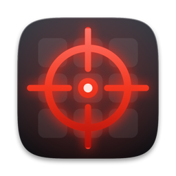

<p align="center">
  
</p>

<h1 align="center">Terminator</h1>

<p align="center">
  Quit all your Mac apps in one go, with a checklist so you stay in control.
</p>

---

## What it does

Open Terminator and it lists every app you have running. Everything starts checked: untick anything you want to keep, then click **Terminate**. The checked apps are force quit, so any unsaved work in them is lost, which is why nothing happens until you confirm.

- **Safe by default.** Cancel is the default button, so an accidental <kbd>Return</kbd> does nothing. <kbd>Esc</kbd> cancels too.
- **Only your apps.** Finder, the Dock and other system processes never show up in the list, and neither does Terminator itself.
- **Select All / Deselect All.** One button flips the whole list.
- **Keyboard friendly.** <kbd>Tab</kbd> / <kbd>Shift</kbd>+<kbd>Tab</kbd> move around, <kbd>Space</kbd> toggles a row or presses a button.

## Install

1. Download the latest `Terminator-x.y.dmg` from [Releases](https://github.com/TheOriUHD/terminator/releases).
2. Open it and drag **Terminator** onto **Applications**.

Needs macOS 12 or later. It's a universal app, so it runs on Apple silicon and Intel.

> **First launch:** Terminator isn't notarized yet, so macOS will warn that it can't check the app for malware.
> Open **System Settings → Privacy & Security**, scroll down and click **Open Anyway**.
> (On macOS 14 and earlier you can also right-click the app and choose **Open**.)

## Build from source

You only need the Xcode Command Line Tools (`xcode-select --install`).

```bash
./scripts/build-app.sh   # build/Terminator.app
./scripts/build-dmg.sh   # build/Terminator-<version>.dmg, the drag-to-Applications installer
```

The installer's window is laid out through Finder, so the first run of `build-dmg.sh` may ask whether your terminal can control Finder. Allow it, and don't mind the Finder window that flashes up while it works.

## Releasing

1. Bump `CFBundleShortVersionString` in `Info.plist`.
2. Run `./scripts/build-dmg.sh`.
3. Publish it:

   ```bash
   gh release create v1.0 build/Terminator-1.0.dmg --title "Terminator 1.0" --generate-notes
   ```

Builds are ad-hoc signed. For a release that opens without the warning above, sign with a Developer ID certificate and notarize the DMG:

```bash
SIGN_IDENTITY="Developer ID Application: Your Name (TEAMID)" ./scripts/build-dmg.sh
xcrun notarytool submit build/Terminator-1.0.dmg --keychain-profile "notary" --wait
xcrun stapler staple build/Terminator-1.0.dmg
```

## Project layout

| Path | What it is |
| --- | --- |
| `main.swift` | The whole app |
| `Info.plist` | Bundle info (the version lives here) |
| `AppIcon.icns` | The app icon |
| `scripts/build-app.sh` | Builds the universal `.app` |
| `scripts/build-dmg.sh` | Builds the installer disk image |
| `scripts/make-icon.swift` | Draws the app icon |
| `scripts/make-dmg-background.swift` | Draws the installer window's background |

## License

[MIT](LICENSE)
